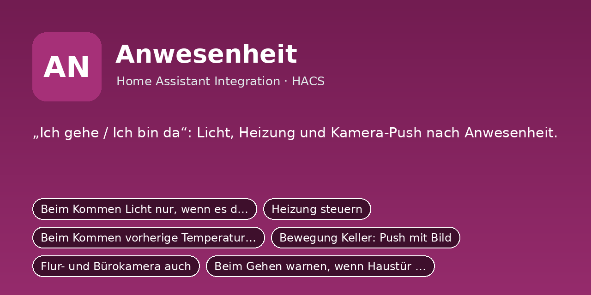

# Anwesenheit

„Ich gehe / Ich bin da“: Licht, Heizung und Kamera-Push nach Anwesenheit.

Python-Integration für Home Assistant (HACS). Sie ersetzt das bisherige YAML-Paket
`anwesenheit/packages/anwesenheit.yaml`: Einstellungen sind jetzt eigene Entitäten (Schalter, Zahlen, Auswahlfelder,
Uhrzeiten), die Logik läuft in Python statt in Automationen und Skripten.

## Installation

1. HACS → Integrationen → ⋮ → **Benutzerdefinierte Repositories** →
   `https://github.com/DerGnom1977/ha-anwesenheit` als Kategorie **Integration** hinzufügen.
2. **Anwesenheit** installieren und Home Assistant neu starten.
3. Einstellungen → Geräte & Dienste → **Integration hinzufügen** → *Anwesenheit*.
4. Das Dashboard aus `dashboards/anwesenheit_dashboard.yaml` anlegen (Raw-Konfigurationseditor).

Manuell: Ordner `custom_components/anwesenheit` nach `/config/custom_components/` kopieren.

## Einrichtung

Beim Hinzufügen (und später über „Konfigurieren“) werden diese Angaben abgefragt:

- **Notify-Dienst Person 1** (`notify_person1`), Standard: `mobile_app_mein_handy`
- **Notify-Dienst Person 2** (`notify_person2`), Standard: `mobile_app_partner_handy`
- **Person Person 1** (`person_person1`), Standard: `person.person1`
- **Person Person 2** (`person_person2`), Standard: `person.person2`
- **Haustür-Schloss (für Warnung)** (`lock`), Standard: `lock.haustuer`
- **Drucker druckt (für Warnung)** (`drucker`), Standard: `binary_sensor.drucker_druckt`
- **Sonne** (`sonne`), Standard: `sun.sun`

## Was du anpassen musst

Alle Standardwerte oben sind **Platzhalter/Beispiele**. Passe sie beim Einrichten an dein System an:

- **Notify-Dienste** (`notify_person1`, `notify_person2`): Name deines Handy-Dienstes ohne `notify.`,
  z. B. `mobile_app_mein_handy` → bei dir `mobile_app_<gerätename>` (Entwicklerwerkzeuge → Aktionen → „notify“).
  „Person 1/Person 2“ sind frei; die Schalter *Push an Person 1/2* schalten die jeweilige Meldung.
- **Entitäten** (`sensor.…`, `camera.…`, `person.…`, `todo.…` usw.): auf die echten Entitäts-IDs aus
  Einstellungen → Geräte & Dienste → Entitäten ändern. Leere Felder sind Pflicht, wenn die Funktion genutzt wird.
- **Dashboard** (`dashboards/anwesenheit_dashboard.yaml`): enthält Entitäts-IDs der Integration; wenn du Namen
  oder Räume änderst, dort per Suchen/Ersetzen nachziehen.
- Später jederzeit unter Einstellungen → Geräte & Dienste → *Anwesenheit* → **Konfigurieren** änderbar.

## Umstieg vom YAML-Paket

1. Das alte Paket `anwesenheit/packages/anwesenheit.yaml` (und sein Dashboard) aus `/config/packages/` entfernen
   und Home Assistant neu starten, damit Helfer, Automationen und Skripte nicht doppelt laufen.
2. Integration einrichten. Neue Entitäten haben dieselben Namen wie die alten Helfer, nur mit
   anderer Domain, z. B. `input_boolean.xyz` wird `switch.xyz`, `input_number.xyz` wird `number.xyz`,
   `input_select.xyz` wird `select.xyz`, `input_datetime.xyz` wird `time.xyz`.
3. Eigene Automationen und Dashboards, die alte Entitäten nutzen, entsprechend anpassen.
4. Die alten Standardwerte sind schon eingebaut, die Einstellungen bleiben nach Neustarts erhalten.

## Dienste

- `anwesenheit.gehen` – Licht aus, Heizung runter. Läuft nur, wenn sonst niemand da ist (außer bei „erzwingen“).
- `anwesenheit.kommen` – Licht an, Heizung hoch.
- `anwesenheit.testlauf` – Zeigt per Push, was „Ich gehe“ und „Ich bin da“ jetzt tun würden.

## Entitäten

### Schalter

- `switch.anwesenheit_nur_dunkel` – Beim Kommen Licht nur, wenn es dunkel ist
- `switch.anwesenheit_heizung_aktiv` – Heizung steuern
- `switch.anwesenheit_heizung_wiederherstellen` – Beim Kommen vorherige Temperatur wiederherstellen
- `switch.anwesenheit_kamera_push` – Bewegung Keller: Push mit Bild
- `switch.anwesenheit_kamera_weitere` – Flur- und Bürokamera auch
- `switch.anwesenheit_warn_haustuer` – Beim Gehen warnen, wenn Haustür offen
- `switch.anwesenheit_warn_drucker` – Beim Gehen warnen, wenn Drucker druckt
- `switch.anwesenheit_ziel_person1` – Push an Person 1
- `switch.anwesenheit_ziel_person2` – Push an Person 2
- `switch.anwesenheit_licht_wohnzimmer_gehen` – Wohnzimmer: beim Gehen aus
- `switch.anwesenheit_licht_wohnzimmer_kommen` – Wohnzimmer: beim Kommen an
- `switch.anwesenheit_licht_ecke_gehen` – Wohnzimmer Ecke: beim Gehen aus
- `switch.anwesenheit_licht_ecke_kommen` – Wohnzimmer Ecke: beim Kommen an
- `switch.anwesenheit_licht_sofa_gehen` – Sofa: beim Gehen aus
- `switch.anwesenheit_licht_sofa_kommen` – Sofa: beim Kommen an
- `switch.anwesenheit_licht_esszimmer_gehen` – Esszimmer: beim Gehen aus
- `switch.anwesenheit_licht_esszimmer_kommen` – Esszimmer: beim Kommen an
- `switch.anwesenheit_licht_tv_gehen` – TvLicht: beim Gehen aus
- `switch.anwesenheit_licht_tv_kommen` – TvLicht: beim Kommen an
- `switch.anwesenheit_licht_h618c_gehen` – H618C: beim Gehen aus
- `switch.anwesenheit_licht_h618c_kommen` – H618C: beim Kommen an
- `switch.anwesenheit_licht_flur_gehen` – Flurlicht: beim Gehen aus
- `switch.anwesenheit_licht_flur_kommen` – Flurlicht: beim Kommen an

### Zahlenwerte

- `number.anwesenheit_verzoegerung` – Erst umschalten nach
- `number.anwesenheit_helligkeit` – Helligkeit beim Kommen
- `number.anwesenheit_heizung_wohnzimmer_weg` – Wohnzimmer: Temperatur, wenn niemand da
- `number.anwesenheit_heizung_wohnzimmer_da` – Wohnzimmer: Temperatur, wenn jemand da
- `number.anwesenheit_heizung_wohnzimmer_gemerkt` – Wohnzimmer: gemerkte Temperatur
- `number.anwesenheit_heizung_bad_weg` – Bad: Temperatur, wenn niemand da
- `number.anwesenheit_heizung_bad_da` – Bad: Temperatur, wenn jemand da
- `number.anwesenheit_heizung_bad_gemerkt` – Bad: gemerkte Temperatur

### Auswahlfelder

- `select.anwesenheit_modus` – Modus
- `select.anwesenheit_wer` – Wer zählt?

### Sensoren

- `sensor.anwesenheit_anzeige` – Anwesenheit Anzeige
- `sensor.anwesenheit_anzahl_zuhause` – Anwesenheit Anzahl zuhause

### Binärsensoren

- `binary_sensor.anwesenheit_jemand_da` – Anwesenheit Jemand da
- `binary_sensor.anwesenheit_niemand_da` – Anwesenheit Niemand da

### Knöpfe

- `button.anwesenheit_ich_gehe` – Ich gehe
- `button.anwesenheit_ich_gehe_erzwingen` – Trotzdem alles aus
- `button.anwesenheit_ich_bin_da` – Ich bin da
- `button.anwesenheit_testlauf` – Testlauf (nur melden)
- `button.anwesenheit_standardwerte` – Standardwerte setzen

## Hinweis

Die Integration wurde aus dem bestehenden YAML-Paket portiert und ist noch nicht in einer laufenden
Home-Assistant-Instanz getestet. Bitte beim ersten Einsatz die Logbuch-/Protokoll-Meldungen
(`custom_components.anwesenheit`) im Blick behalten.
